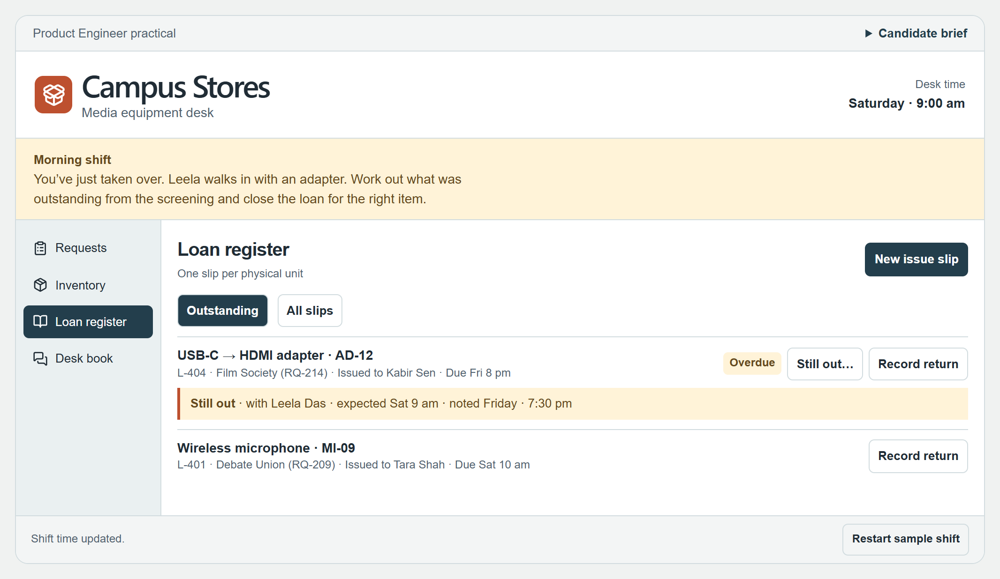
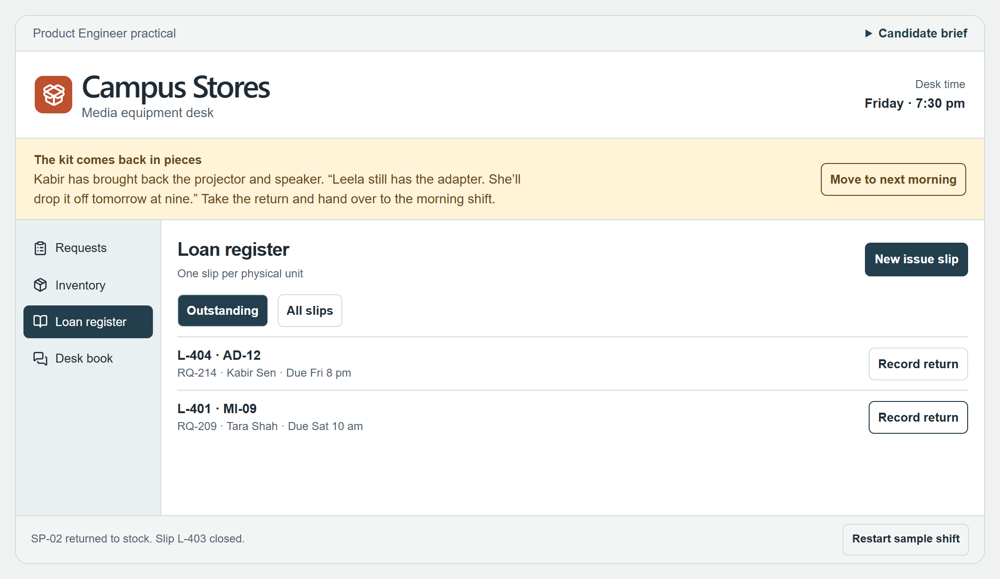
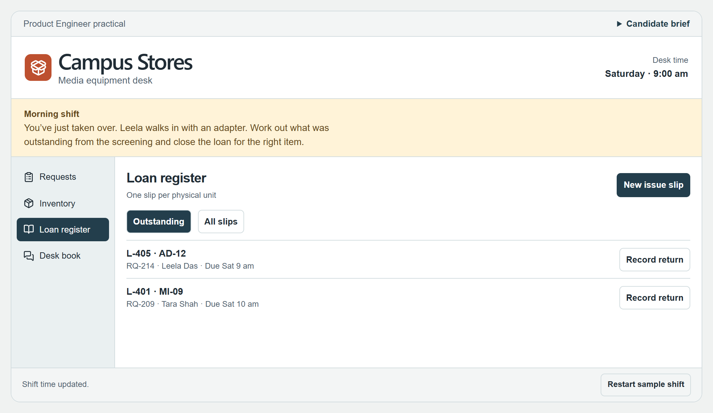
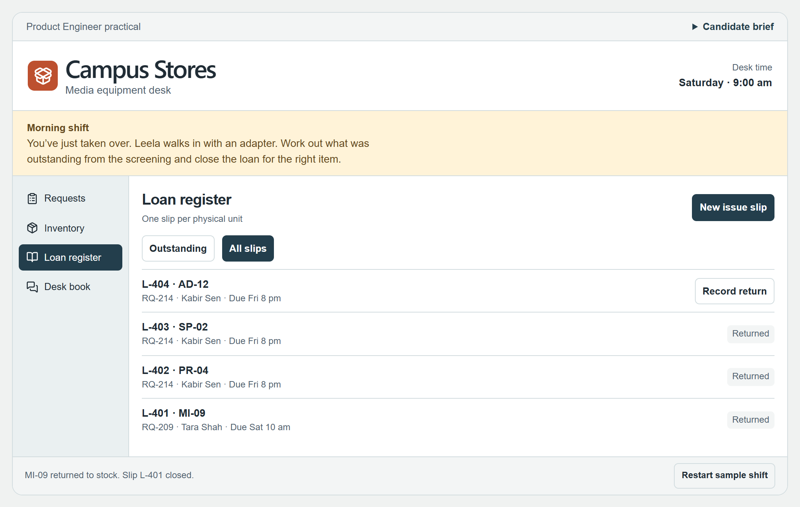
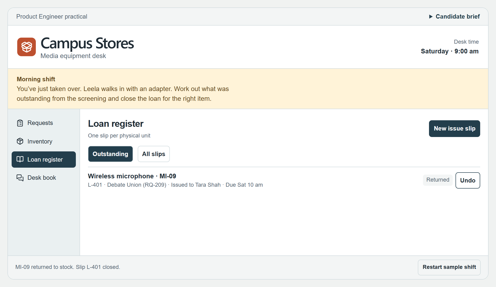
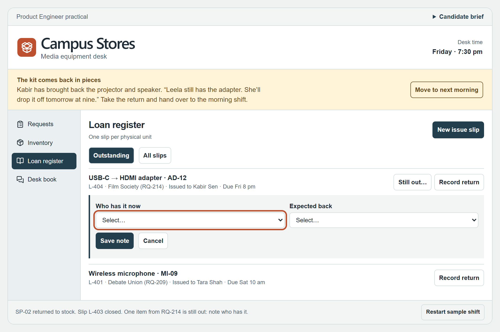
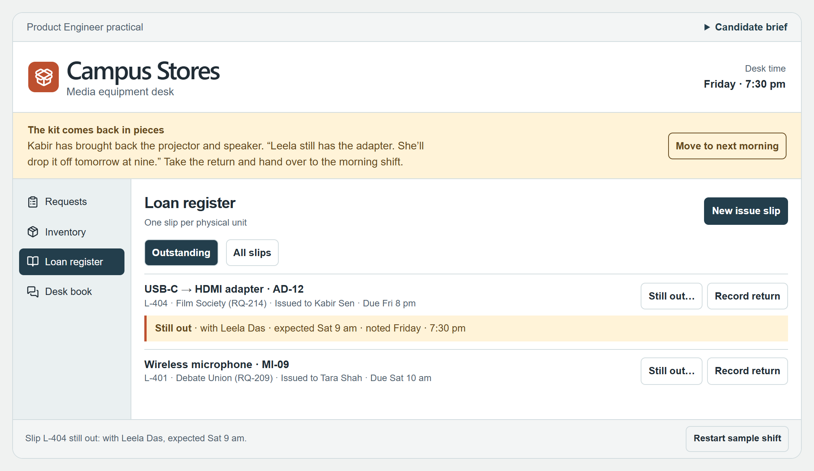

# Campus Stores

Fork of [virinchi-healthcare/campus-stores](https://github.com/virinchi-healthcare/campus-stores) for the Product Engineer work sample. This README covers what I found while working the sample shift, the one change I made, and how to run it.

## Summary

- I would keep this product. Its core record, one slip per physical unit, is right, and the problem I found was small to fix.
- It handles a partial return well. When two of three items came back, I closed two slips and the third stayed open.
- It has no way to record why a slip is still open. I added one: an open slip can now show who has the item and when it is expected back.
- I also added **Undo** for the most recent return, because a mistaken click could not be reversed.
- The change is in [`app.js`](app.js) (search for `still` and `undo`), about 160 lines, with a few rules in [`styles.css`](styles.css).

The register on Saturday morning, when Leela brings back the adapter:

| Original | This fork |
| --- | --- |
|  |  |

## Trying the change

1. Open the [live demo](https://vaibhavkev.github.io/campus-stores/), or open `index.html` in a browser.
2. In **Loan register**, issue the Film Society's three items to Kabir Sen.
3. Click **Move to return time**.
4. Record the projector and the speaker as returned. The adapter's slip asks who has it.
5. Choose Leela Das and Sat 9 am, save, then click **Move to next morning**.

## Would I keep this product?

Yes. The practical alternatives for a desk this size are a paper register or a spreadsheet, and the product does things neither can:

- It refused to issue a camera that was not on the approved request.
- It never offered the projector that is in repair.
- Inventory updated on its own when I recorded a return.

The one place a paper register does better is that you can write a note next to an entry, such as "Leela has it, back at 9". The product had no equivalent. That is a missing feature, not a design problem, and it was a small change to add.

I would reconsider if the desk grew much larger. With a few hundred open slips the register would need search, and issuing items one form at a time would be too slow.

## What works well: partial returns

At Friday 7:30 pm, Kabir returns the projector and the speaker but not the adapter.

I clicked **Record return** on the projector's slip and on the speaker's slip. Both closed, the adapter's slip stayed open, and Inventory showed the two returned units as on the shelf.



This works because the register keeps one slip per physical unit. The same rule makes pickup slower, since each item needs its own slip, but it is what makes a partial return simple.

## What I changed: slips that stay open

### The problem

After that return, the morning shift needs to know that Leela has the adapter and will bring it at 9 am. The open slip has one button, **Record return**, and cannot be edited. I tried the two options the product allows.

**Option 1: leave the slip as it is and write a note in the Desk book.** On Saturday morning the register looked like this:


The register does not mention the adapter, the Film Society, Leela, or that the slip is overdue. That information is in a free-text note on a different page.

**Option 2: record the adapter as returned and issue it again to Leela.** The issue form accepts Leela Das with a return time of Sat 9 am, even though the request says Friday 8 pm.



The register now shows Leela and 9 am, but the history contains a return that did not happen, and Inventory briefly showed the adapter as on the shelf.

Neither option is good. The first keeps the record accurate but hides the information from the next shift. The second shows the information but makes the record wrong.

### The change

The change is one thing: an open slip can be marked **Still out**, with who has the item and when it is expected.

- When a return leaves one item of a request outstanding, that slip asks for the two details straight away.
- The slip stays open under the original collector and due time, so the history stays accurate.
- A slip offers **Still out** only once it is overdue or part of its request has come back. Pickup looks the same as before.

The note is only useful if the next shift can read the row it sits on. So each row now shows the item type and the club as well as the codes, and shows **Overdue** after the due time. The Desk book lists the same note, read from the slip.

The change does not extend the loan or approve a late return. It records what the desk was told.

Due times are compared using a fixed table for this sample shift. A real version would store timestamps.

### A second, smaller change: undoing a return

In the original, **Record return** is one click with no confirmation. The row then disappears and the rows below move up, so a second click in the same place closes a different slip, with no way to reopen it. I closed the Debate Union's microphone slip this way while testing, and Inventory then showed the microphone as on the shelf.

Now the slip just returned stays where it was, marked **Returned**, with an **Undo** button until the next return or a change of page.

| Original | This fork |
| --- | --- |
|  |  |

The brief asks for one change and this is a second. I added it because a wrong return leaves the record wrong without anyone noticing, which is the same kind of failure as the first change addresses.

### The same shift with the change

Pickup on Friday 3:45 pm is unchanged.

At Friday 7:30 pm, after the projector and speaker are returned, the adapter's slip asks who has it:



After choosing Leela Das and Sat 9 am:



On Saturday 9:00 am, the register shows which slip the adapter belongs to:


**Record return** closes it. The microphone's slip, due at 10 am, is unaffected.

## What I would keep

- **One slip per physical unit.** It is why the partial return worked. Merging slips into one loan per request would make pickup faster and break this.
- **The checks on the issue form.** With the film starting in fifteen minutes, they stopped me issuing the wrong item.
- **Inventory status calculated from the slips.** There is no second list that can drift out of step.
- **The Desk book.** Messages from clubs and general notes still need somewhere to go. It should not be the only place a loan's status lives.

## Checking it at a real counter

I would watch the morning shift change, and wait for an item that was left out overnight to be returned by someone other than the named collector.

The change has helped if the person on shift closes the correct slip without opening the Desk book or asking a colleague who took the item out. If they still need to do either, it has not.

## Known issues I did not change

These are unchanged from the original:

- Issuing three items takes 18 clicks and selections, because the form is filled in once per item.
- Only the most recent return can be undone. Older returns still cannot be reopened.
- Nothing checks that the item handed over is the unit on the slip. Each row shows the unit's tag, such as AD-12, so the person at the desk can match it against the item, but two adapters share a bin and the app accepts the click either way.
- The issue form does not check the collector or the return time against the request.
- Validation messages appear only in the footer.

## Running the app

Open `index.html` in a modern browser. It runs from disk and works offline. **Restart sample shift** restores the starting records.

To serve it over local HTTP:

```sh
python3 -m http.server 8000 --bind 127.0.0.1
```

## Tests

```sh
node tests/walkthrough.mjs
```

This replays the three-step shift in headless Chrome and runs 14 checks against the page. It requires Node 22 or newer and Chrome or Edge, with no other dependencies.

## Licence notices

Icon licence notices are in [third-party/lucide-LICENSE.txt](third-party/lucide-LICENSE.txt).
